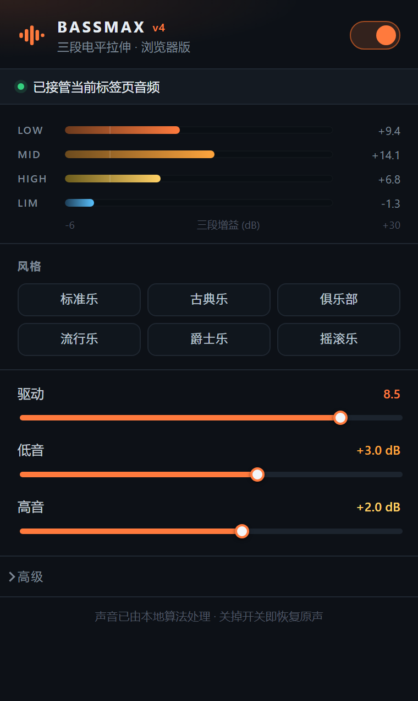

# BassMax 浏览器版 — Chrome / Edge 扩展

把 `bassmax_dshow/bassmax_core.hpp`（BassMax v4 核心）逐行移植成 **AudioWorklet**，对**当前标签页**的音频做实时处理：静态 EQ → 三段分频 → 每段电平拉伸 → 软饱和 → 前瞻限幅。



---

## 为什么这样搭

| 方案 | 问题 |
|---|---|
| 内容脚本 + `createMediaElementSource` | 跨域音源会直接静音；AudioWorklet 模块要过页面 CSP（YouTube、各类 SPA 基本都会拦） |
| Web Audio 原生节点拼 | 做不出「测电平 → 按目标电平拉伸 → 段内 tanh 饱和」这条链路，音色对不上 |
| **`tabCapture` + 离屏文档 + AudioWorklet** | 拿的是整条标签页混音，没有 CORS/CSP 问题，DSP 逐样本可控 |

音频路径：

```
标签页混音 --tabCapture--> 离屏文档 --MediaStreamSource--> AudioWorklet(BassMax)
        --> destination --> 你的耳机
```

Chrome 一旦开始捕获，就会把该标签页的本地输出改由扩展播放，所以**不会**出现原声和效果声叠在一起的双份声音。

---

## 安装

1. 打开 `chrome://extensions`（Edge 是 `edge://extensions`）
2. 右上角开 **开发者模式**
3. **加载已解压的扩展程序** → 选本目录（`bassmax_chrome_ext`）
4. 打开一个正在放歌/放视频的标签页 → 点工具栏的 BassMax 图标 → 打开开关

最低 Chrome 116（用到 `offscreen.hasDocument()` 和多 reason 的离屏文档）。

---

| 参数 | 范围 | 说明 |
|---|---|---|
| 驱动 | 0–10 | 电平拉伸量的线性缩放。0 = 旁路（EQ 也全平才逐样本不动），10 = 完整拉伸量 |
| 低音 | ±12 dB | 100 Hz 低架，叠加在预设之上 |
| 高音 | ±12 dB | 9 kHz 高架，**后置**在限幅之后，不进电平检测 → 只改音色不改动态 |
| 风格 | 6 个预设 | 标准乐 / 古典乐 / 俱乐部 / 流行乐 / 爵士乐 / 摇滚乐，与原版界面顺序一致 |
| 总增益（高级） | 0–6 dB | 信号链末端补偿，0 表示用算法默认 2.5 dB |
| 1 kHz 微调（高级） | ±6 dB | 叠加到预设的 900 Hz 峰值上 |

三段电平表显示的是**每段实际加了多少增益**（这就是算法本体：`gain = clamp(S·(T−L), FLOOR, C)`），LIM 那一行是前瞻限幅器的工作量。

---

## 与 C++ 版的一致性

移植不是"听起来像"，是逐样本对齐的。三层验证：

| 对比 | 条件 | 结果 |
|---|---|---|
| C++ `Core` ⇄ JS `BXCore`（node） | 8 s 合成信号（55 Hz 低音 + 鼓点 + 和弦 + 8 k 镲片 + 静音），驱动 0.85 / 低音 +2 / 爵士乐 / 9 k +3 / 1 k +1.5，48 kHz | RMS 差 **−106.9 dBFS**，相对信号 **−97.4 dB** |
| 同上 | 真实音乐 8 s，驱动 1.0 / 低音 +6 / 摇滚乐，44.1 kHz | RMS 差 **−113.4 dBFS**，相对信号 **−101.1 dB** |
| 浏览器 AudioWorklet ⇄ node `BXCore` | 48 000 帧离线渲染，同参数 | **完全一致**（RMS、峰值、采样点 9 位小数全同） |

前两项那点残差来自 C++ 用 `float`、JS 用 `double` 的舍入差（JS 侧在所有 C++ 是 float 的位置都做了 `Math.fround` 截断）。第三项说明真正跑在浏览器里的那份代码与离线参考**逐位相同**。

---

## 已知限制（重要）

1. **一次只能接管一个标签页**，切标签页不会自动跟随；目标页刷新或跳转后要重新开启。
2. **DRM 内容拿不到声音**。Netflix / Spotify / 各类 EME 加密流经 `tabCapture` 是静音，扩展无能为力——这是 Chrome 的限制，不是 bug。
3. **有额外延迟**。tabCapture 走一圈缓冲，通常 100 ms 量级，听歌无感，长时间看视频对白可能轻微口型不同步。
4. 只处理**当前标签页**，不处理其他窗口/系统声音。要全局接管得走虚拟声卡（VB-Cable 之类），那是另一个方案。
5. 采样率按 `AudioContext` 实际值算系数，蓝牙耳机 44.1k 也不会跑偏。

---

## 目录

```
manifest.json               MV3 清单
background.js               service worker: 申请流 ID / 拉离屏文档 / 存参数
offscreen.html|js           音频管线: tabCapture -> 分频 -> worklet -> 输出
worklet/bassmax-worklet.js  DSP 本体 (bassmax_core.hpp 的移植) + AudioWorkletProcessor
popup.html|css|js           控制面板
common.js                   默认参数 / 预设元数据 (后台与弹窗共用)
icons/                      图标
test/                       验证脚本 (见下)
```

## 验证脚本

```bash
cd test
python gen_test_wav.py            # 生成合成测试信号 in.wav
bash build_ref.sh                 # 用 MSVC 编译 C++ 参考渲染器 (需 VS + Win SDK)
./render_ref.exe in.wav ref.wav 0.85 2
node render_js.js in.wav js.wav 0.85 2
python compare_wav.py ref.wav js.wav     # 逐样本比较两个输出

node wt_ref.js                    # node 侧参考
node cdp_run.js                   # 起无头浏览器跑 worklet, 结果应与 wt_ref.js 完全一致
python make_icons.py              # 重新生成图标
python make_preview.py            # 生成 popup 静态预览
```

`cdp_run.js` 会把 `test/wtest.html|js` 临时拷到扩展根目录再删掉——`chrome-extension://` 页面才能加载 worklet 模块，`file://` 会被 CORS 挡。

---

## 隐私

不联网、不注入内容脚本、不读页面 DOM。只在本地把标签页声音过一遍算法，参数存在 `chrome.storage.local`。
